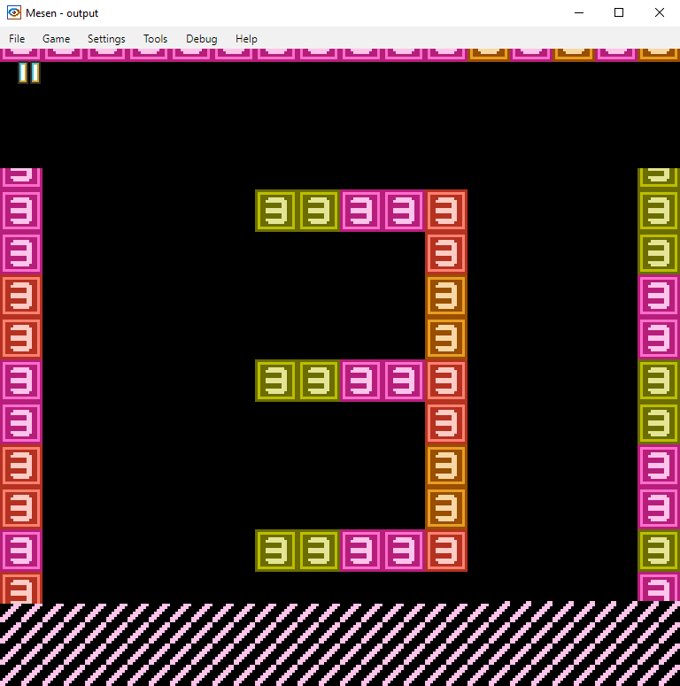

# MMC3 NES starter project version 2 (November 2026)

Intended to be a jumping off point for MMC3 based NES games.

Contains basic, expandable implementations of:

* Improved, simplified scrolling code
* PRG bank switching
* CHR bank switching
* Level switching
* Status bar
* Controller input



# A note on AI contributions:

This project is intentionally written and maintained by humans. Please don't use AI coding agents or code-generation tools to modify the project. This isn't an anti-AI statement, it's simply a choice I'm making for this project. Thanks for respecting it.

# Code conventions

* File names: lowercase with underscores eg. my_code.asm.  
* Zero page variables: prefix and description with underscores eg. zp_player_x  
* Ram variables: Omit the prefix eg. player_lives  
* Label names: lowercase with underscore (verbs for routines, nouns for data) eg. load_palette, palette_data  
* Tables: lowercase with underscore, end with _table eg. sin_table  
* Constants: all caps with underscores eg. PLAYER_SPEED  
* Macros: all caps with underscores eg. LOAD_POINTER  
* Local labels: eg. @loop:  
* Hardware Registers: always name them after NES docs: rg. PPUCTRL, PPUMASK, PPUSTATUS, OAMDATA, PPUADDR, PPUDATA  
* Structured pairs: eg. zp_sprite_lo, zp_sprite_hi  
* Procedures: use verbs, lower case, underscores eg. update_player  
* Instructions: lower case eg. lda, clc  
* Pointers: use assembly time aliases eg.  
  -  ptr:    .res 2  
  -  ptr_lo = ptr  
  -  ptr_hi = ptr+1  

* Keep indexed operands tightly packed (no ascii space after ',') example:

```
lda (my_pointer),y
```


# Order of segments

General order in source files:

1. CONSTANTS
2. .segment "HEADER"
3. .segment "ZEROPAGE"
4. .segment "BSS"
5. .segment "RODATA"
6. .segment "CODE"
7. .segment "VECTORS"
8. .segment "CHR"

Do not include empty segments.

# Example makefile / how to assemble

```
begin_build:	
	echo " DEBUG build start ->"
	ca65 src/main.asm -g -o build/main.o
	ca65 ./data/stage1_data.asm -g -o build/stage1_data.o
	ca65 ./data/stage2_data.asm -g -o build/stage2_data.o
	ca65 ./data/stage3_data.asm -g -o build/stage3_data.o
	ld65 -o output.nes -C ld65.cfg build/main.o build/stage1_data.o build/stage2_data.o build/stage3_data.o --dbgfile build/output.dbg
	ld65 -C ld65.cfg -o output.nes build/main.o build/stage1_data.o build/stage2_data.o build/stage3_data.o --mapfile build/output.map
	echo "------- DEBUG build S-U-C-C-E-S-S.-------"
```